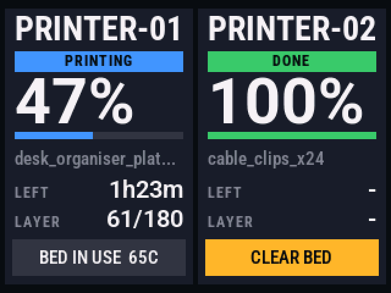
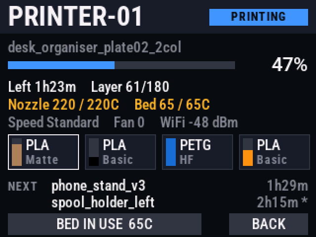
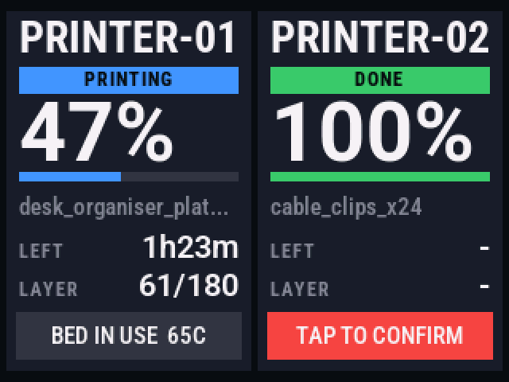

# BamHUD

**A heads-up display for [Bambuddy](https://github.com/maziggy/bambuddy).** A desk touchscreen for Bambu Lab printers managed by Bambuddy,
built on the cheap **ESP32-2432S028 "Cheap Yellow Display"** (CYD) and MicroPython.

| Main view | Detail view (tap a card) | Clear-bed confirm |
|---|---|---|
|  |  |  |

*(Screenshots are rendered by `tools/simulate.py --demo` from the real display code, using invented data.)*

## Features

- **Two printers at a glance**: name, state, big progress %, progress bar, file name, time left, layer.
- **Bed status + CLEAR BED button**: when Bambuddy is waiting for a plate to be cleared, an amber
  button appears; tap it, then **TAP TO CONFIRM** within 5 s, and Bambuddy's scheduler can start
  the next queued job.
- **Detail view**: temperatures (actual / target), speed, fan, Wi-Fi signal, **AMS filament** with real
  spool colours and a remaining-filament gauge, the next queued jobs with print times, HMS errors.
- **Sleeps when idle** (default 15 min with nothing printing). The first tap only wakes it; it also
  wakes itself when a print starts, finishes and needs clearing, or reports an error.
- **Built-in web page** with live status, device health, settings (poll interval, sleep time,
  Bambuddy URL), screen on/off and reboot.
- **Over-the-air updates**: push new code over Wi-Fi; uploads are password-protected and validated
  on the device before they replace the running files.
- **Smooth anti-aliased text** (Roboto / Roboto Condensed) with fixed-width digits, flicker-free updates.
- **PC simulator** that renders the real display code to PNGs, so layouts can be checked without the hardware.

## What you need

| | |
|---|---|
| Display | ESP32-2432S028 / 2432S028R "Cheap Yellow Display" (2.8", 320×240, ILI9341 + XPT2046 resistive touch, CH340 USB) |
| Server | A running **Bambuddy** instance reachable over HTTP from the display, with **auth disabled** on your LAN (the display sends no API key) |
| Network | 2.4 GHz Wi-Fi (the ESP32 can't join 5 GHz) |
| PC | Python 3.9+ and a USB cable. Windows, macOS or Linux. (On Windows, [Thonny](https://thonny.org)'s bundled Python is fine.) |

> Tested with MicroPython **v1.29.0** and Bambuddy **v1.2.5.7** on two Bambu Lab A1 printers with AMS lite.
> Other CYD revisions may need different display settings; see *Troubleshooting*.

## More than two printers?

BamHUD shows **two printers**, one per card. That's what it was built for (a two-printer farm), and
it's what a 320×240 screen shows well at a glance. If you have more, there are two routes:

**1. One BamHUD per pair of printers (recommended, no code changes).** The boards are cheap, and
each one stays a glance-able display that can sit beside its two printers. For each unit, give
`config.py` its own `PRINTER_IDS` and a unique `HOSTNAME`:

```python
# unit 1                                  # unit 2
PRINTER_IDS = (1, 2)                      PRINTER_IDS = (3, 4)
HOSTNAME = "bamhud"                       HOSTNAME = "bamhud-2"
```

Then deploy to each with `python tools/deploy.py --host bamhud-2.local ...`. The printer ids are the
ones Bambuddy uses (`GET /api/v1/printers/` lists them). Every unit talks to Bambuddy on its own.

**2. Modify the code to show more on one screen.** It's doable, but it's real layout work. Two approaches:

- **Pages**: keep the two-card layout and add a page indicator. A tap on the header or a swipe moves
  to the next pair, and it could auto-cycle every few seconds while idle and jump to any printer
  that needs attention (CLEAR BED or an error). This is the least disruptive option: in `app.py`, make
  `data` hold every printer, add a `page` index, and draw `data[2*page : 2*page+2]` with the existing
  `draw_main()`.
- **Grid**: four smaller cards (2×2, about 154×112 each) with name, badge, % and bed status only. Tap
  for the existing detail view. This needs a new `draw_main()` layout and smaller fonts (see *Fonts*).

Either way, keep in mind:
- Each printer adds about 0.1–0.9 s of HTTP polling per cycle, so raise `POLL_SECONDS` with
  more printers. The loop is single-threaded, and touch waits while it polls.
- Each printer's slimmed status costs about 1 KB of RAM. A handful is fine, but see *Memory* before going big.
- Use `tools/simulate.py` to iterate on the layout before touching the hardware.

## How it works

```
Bambuddy server ──HTTP (poll every 4 s)──▶ ESP32 CYD ──SPI──▶ 320×240 display
   /api/v1/printers/{id}/status              app.py          XPT2046 touch
   /api/v1/queue/?status=pending             web.py ◀──HTTP── your browser / tools/deploy.py
   /api/v1/printers/{id}/clear-plate (only on confirmed tap)
```

- `main.py` → `app.run()`: one cooperative loop that reads touch, polls Bambuddy, redraws only the
  fields that changed, handles sleep, and services the web server.
- Text uses pre-rendered 4-bit anti-aliased fonts (`*.bfn`) blended against the background at draw time.
- Big modules are **precompiled to `.mpy`** on the PC. This matters on the ESP32: see *Memory* below.

---

## Build & first-time setup

### 1. Get the code and PC tools

```bash
git clone https://github.com/<you>/BamHUD.git
cd BamHUD
python -m pip install -r requirements.txt     # esptool, pyserial, mpy-cross 1.29, Pillow
```

`mpy-cross` **must match the MicroPython version on the board** (1.29.x ↔ .mpy format v6.3).
If you flash a different MicroPython version, install the matching `mpy-cross`.

### 2. Find the serial port

Plug the CYD in by USB. It shows up as a CH340 serial port: `COM3`-style on Windows (Device Manager → Ports),
`/dev/ttyUSB0` on Linux, `/dev/cu.wchusbserial*` on macOS. Examples below use `COM3`; substitute yours.

### 3. Back up the factory firmware (recommended)

On these boards the automatic reset into download mode often **doesn't work** ("Wrong boot mode
detected (0x13)"). What does work: start the command, then **press and hold the BOOT button** until you
see `Connected`/`Stub flasher running`, then release.

```bash
python -m esptool --port COM3 --connect-attempts 30 read-flash 0 0x400000 cyd-factory-4MB.bin
```

Keep that file somewhere safe; it restores the board exactly as shipped (see *Restoring*).

### 4. Flash MicroPython

Download the **ESP32_GENERIC** firmware (v1.29.0) from https://micropython.org/download/ESP32_GENERIC/
and flash it **in one command** (hold BOOT again while it connects):

```bash
python -m esptool --port COM3 --connect-attempts 30 write-flash --erase-all -z 0x1000 ESP32_GENERIC-20260824-v1.29.0.bin
```

> Don't run `erase-flash` and `write-flash` as two separate commands: the reset after the erase drops
> the board out of download mode and leaves it blank until you hold BOOT again.

### 5. Configure

```bash
cp config.example.py config.py      # Windows: copy config.example.py config.py
```

Edit `config.py`: Wi-Fi SSID/password, your Bambuddy URL (ending in `/api/v1`), the two Bambuddy
printer ids to show, and a **strong `WEB_PASSWORD`**. `config.py` is git-ignored and is only ever
copied to the board.

### 6. First deploy (USB)

```bash
python tools/deploy.py --usb --port COM3 config.py touch_cal.py ili9341.py font.py touch.py web.py index.html f_name.bfn f_big.bfn f_med.bfn f_small.bfn f_label.bfn app.py main.py
```

`deploy.py` compiles `app.py`, `web.py`, `font.py`, `ili9341.py`, `touch.py`, `calibrate.py` to `.mpy`
(in `build/`), uploads them, and soft-reboots the board. The display shows *Connecting to WiFi…*,
then the two printer cards.

### 7. Calibrate the touch screen (if taps land in the wrong place)

`touch_cal.py` holds the calibration of the unit this was developed on, which may be close for yours.
If taps miss:

```bash
python tools/deploy.py --usb --no-reboot calibrate.py
```

Then open a REPL (e.g. Thonny, or `python -m serial.tools.miniterm COM3 115200`), press Ctrl-C a few
times to stop the app, run `import calibrate`, and tap the centre of each of the 3 crosshairs. It writes
`touch_cal.py` on the board and prints `CAL RESULT (...)`. Copy that line into your local `touch_cal.py`,
then reset the board.

### 8. Find the web page

The display registers the hostname `bamhud`: try **http://bamhud.local/**. Otherwise find its
IP in your router's DHCP list (and give it a reservation). The page shows live status and device health,
and lets you change settings, turn the screen on/off and reboot (password = `WEB_PASSWORD`).

---

## Deploying updates (over Wi-Fi)

```bash
python tools/simulate.py                       # optional: preview the screen as PNGs first (sim/)
python tools/deploy.py app.py                  # compile, upload over Wi-Fi to bamhud.local, reboot
python tools/deploy.py --host 192.168.1.60 app.py web.py index.html
python tools/deploy.py --no-reboot f_med.bfn
python tools/deploy.py --usb --port COM3 app.py   # fallback if the Wi-Fi/web server is down
```

On the device, each upload is written to a temporary file and **validated** before it replaces the
live one: `.py` must compile, `.mpy` must be MicroPython v6 bytecode, fonts must be BFN1, and the page must be
HTML. Only known file names are accepted, and the board deletes `X.py` when `X.mpy` arrives (MicroPython
prefers `.py`). A runtime bug in `app.py` can still stop the web server; recover over USB.

After an update, check `http://<display>/api/status`: `device.last_error` should be empty and
`device.idf_free` (free Wi-Fi memory) should stay above ~15 KB.

### Adding a new module

Add it to `UPLOADABLE` in `web.py` and to `COMPILE` in `tools/deploy.py`, deploy `web.py` and reboot,
then deploy the new module.

---

## Development

### Simulator

```bash
python tools/simulate.py           # live data from your Bambuddy -> sim/*.png (main, detail per printer, demo states)
python tools/simulate.py --demo    # invented data, no network or config.py needed -> docs/screenshot_*.png
```

It imports the real `app.py`, `ili9341.py` and `font.py` with stub hardware: the display's SPI command
stream is emulated into an image. All HTTP **POSTs are refused**, so the simulator can never clear a plate.

### Fonts

Fonts are generated from the TTFs in `fonts/` with `tools/make_font.py`
(4-bit alpha, tight shared height, advance-width glyphs; format documented in the script):

```bash
python tools/make_font.py fonts/RobotoCondensed-Variable.ttf f_name.bfn  --size 28 --wght 700
python tools/make_font.py fonts/Roboto-Variable.ttf          f_big.bfn   --size 52 --wght 700 --chars "0123456789%-"
python tools/make_font.py fonts/Roboto-Variable.ttf          f_med.bfn   --size 20 --wght 600
python tools/make_font.py fonts/RobotoCondensed-Variable.ttf f_small.bfn --size 15 --wght 500 --gamma 1.2
python tools/make_font.py fonts/RobotoCondensed-Variable.ttf f_label.bfn --size 12 --wght 700 --gamma 1.2 --tracking 1
```

### Memory (read before adding features)

On the ESP32, MicroPython's heap and the Wi-Fi driver share the same RAM. The heap starts at 56 KB and,
when full, grows by taking memory from the Wi-Fi driver, **permanently**. A second growth starves Wi-Fi and
networking fails silently (timeouts, DNS errors). The code is shaped around this: precompiled `.mpy`, status
responses slimmed to ~1 KB, the web page streamed from flash, small glyph/colour caches, a streaming queue
parser, and timeouts on every request. Watch `idf_free` on `/api/status` after changes. Details: `CLAUDE.md` §5.5.

### Logs

```bash
python tools/serial_log.py 30 --port COM3      # note: opening the serial port resets the board
```

Set `DEBUG = True` in `config.py` to log taps, redraws and timings.

`CLAUDE.md` is the full developer handbook (pin map, every gotcha, layout coordinates, API fields).

---

## Troubleshooting

| Symptom | Cause / fix |
|---|---|
| esptool: *Wrong boot mode detected (0x13)* | Hold **BOOT** while esptool connects (see step 3). |
| All colours inverted | Panel needs display inversion: `0x21` in `ili9341.py` init (already set). Remove it if your panel is the other kind. |
| Red and blue swapped (e.g. caramel shows as blue) | MADCTL colour-order bit: `0x36` = `0x20` here; try `0x28` on other panels. |
| Upside down | MADCTL `0x20` ↔ `0xE0`, then recalibrate touch. |
| Faint flicker | Wi-Fi power-save current spikes dip the backlight; the code sets `pm=PM_NONE` and lower TX power. Keep those. |
| Taps land in the wrong place | Recalibrate (step 7). |
| Screen frozen / web page times out / `ETIMEDOUT` | Wi-Fi memory exhausted. Check `idf_free`; see *Memory*. Make sure big modules are deployed as `.mpy`. |
| *Connecting to WiFi…* forever | Wrong SSID/password, or a 5 GHz-only network. |
| Cards say NO DATA | Bambuddy URL wrong/unreachable, or Bambuddy auth is enabled (the display sends no API key). |

## Restoring

- **Factory firmware**: hold BOOT and run
  `python -m esptool --port COM3 --connect-attempts 30 write-flash 0x0 cyd-factory-4MB.bin`
- **Clean reinstall**: repeat steps 4–6.

## Security notes

- Keep the display on your LAN; don't expose it to the internet. The web page's status is open to anyone
  on the network; settings, reboot and code uploads require `WEB_PASSWORD` (sent in plain HTTP).
- The only write the display makes to Bambuddy is `clear-plate`, and only after two taps. Clearing a plate
  lets Bambuddy's scheduler start the next queued print, so make sure the bed really is clear.
- Bambuddy's `GET /printers/` response includes printers' LAN access codes; this project never displays,
  logs or stores it.

## Project layout

```
main.py            boot entry: import app; app.run()
app.py             the application (views, polling, touch, sleep, web API glue)
ili9341.py         display driver        touch.py / touch_cal.py   touch driver + calibration
font.py            anti-aliased font renderer (runs on board and PC)
web.py, index.html web server + page     calibrate.py              touch calibration tool
f_*.bfn            generated fonts       fonts/                    source TTFs + OFL licence
config.example.py  copy to config.py     tools/                    deploy, simulate, make_font, serial_log
docs/              README screenshots    CLAUDE.md                 developer handbook
```

## Credits

- [Bambuddy](https://github.com/maziggy/bambuddy) by maziggy, the self-hosted printer manager this display talks to.
- [MicroPython](https://micropython.org).
- [Roboto / Roboto Condensed](https://github.com/googlefonts/roboto-classic) by Google, under the
  SIL Open Font License 1.1 (`fonts/OFL.txt`); the `.bfn` files are bitmap renderings of them under the same licence.
- Not affiliated with Bambu Lab or the Bambuddy project.

## Licence

Code: [MIT](LICENSE). Fonts (`fonts/`, `f_*.bfn`): SIL Open Font License 1.1.
